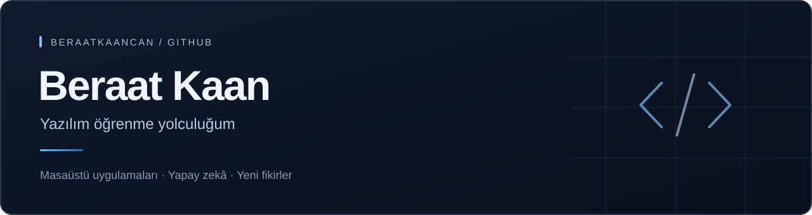

**[↗  Portföy sitemi aç](https://beraatkaancan.github.io/beraatkaancan/)**

### Hakkımda

Merhaba, ben **Beraat Kaan**. Yazılım geliştirmeyi öğrenmek ve günlük hayatta işe yarayan uygulamalar yapmak istiyorum.

Masaüstü uygulamaları, yapay zekâ ve telefon–bilgisayar bağlantısı ilgimi çekiyor. Bu profilde öğrenme sürecimi ve zamanla geliştireceğim projeleri paylaşacağım.

### İlgi alanlarım

`Masaüstü uygulamaları` · `Yapay zekâ` · `Günlük işleri kolaylaştıran araçlar`

 

GitHub · [@beraatkaancan](https://github.com/beraatkaancan)
